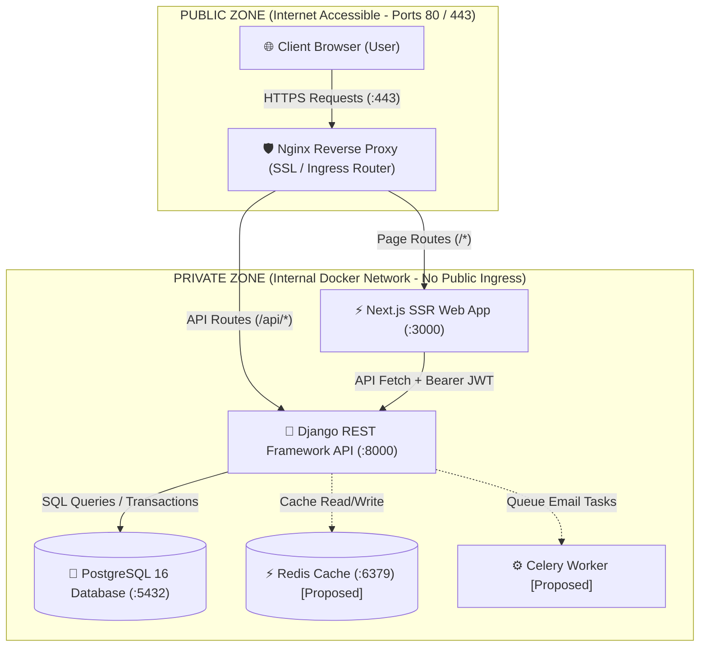
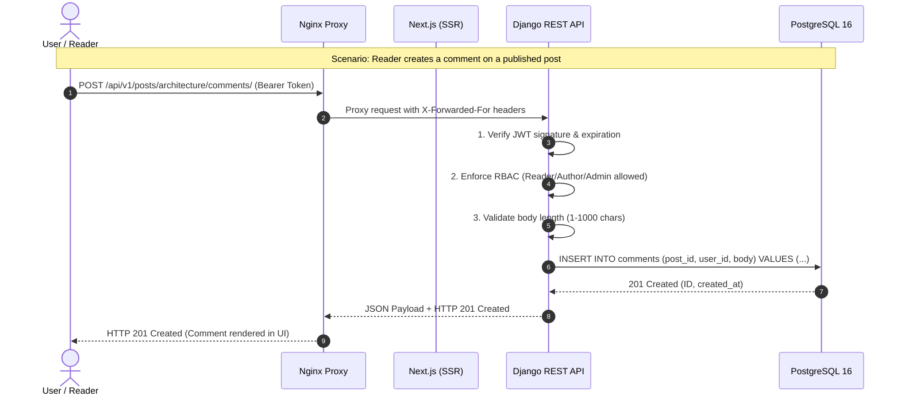

# DevScribe — Architecture & System Design
### Deliverable 02 | FalconXoft Weekend 1 Assessment

This document specifies the software architecture, network topologies, data movement pathways, security boundaries, and infrastructure components for the DevScribe publishing platform.

---

## 1. System Components

The system is decomposed into distinct, single-responsibility services:

1. **Client Tier (Browser):**
   - Renders the responsive user interface, handles client-side form validation, and manages JWT access/refresh state in memory/storage.
2. **Reverse Proxy (Nginx):**
   - Serves as the public ingress gatekeeper. Terminates TLS/SSL, buffers slow client connections, and routes `/api/*` traffic to Django and page requests to Next.js.
3. **Frontend Application Tier (Next.js 14 App Router):**
   - Executes Server-Side Rendering (SSR) for public posts and category pages (optimizing SEO and First Contentful Paint). Provides client-side React interactive views for the Author Studio editor, interactive comments, and the Admin Control Panel.
4. **Backend Application Tier (Django 5.1 & Django REST Framework):**
   - Houses the domain business logic, handles JWT generation/rotation via `djangorestframework-simplejwt`, enforces 3-tier Role-Based Access Control (RBAC), and sanitizes all incoming payloads.
5. **Relational Database Tier (PostgreSQL 16):**
   - Primary source of truth. Enforces referential integrity, foreign key cascade behaviors, check constraints, and provides full-text search indexing through `tsvector` and `GIN` indexes.
6. **In-Memory Cache (Redis) — *Proposed for Phase 2*:**
   - Serves as an in-memory cache for hot post feeds and API rate limiting / request throttling.
7. **Asynchronous Background Worker (Celery) — *Proposed for Phase 2*:**
   - Processes asynchronous tasks such as sending transactional emails (welcome emails, comment alerts) without blocking the HTTP request-response cycle.

---

## 2. Deployment Boundaries: Public vs. Private Zones

Security boundaries are strictly enforced to minimize the system attack surface:

### Security Boundary Guarantees:
- **Zero Direct Database Access:** PostgreSQL port `5432` is bound solely to the internal Docker bridge network (`backend_default`). It is strictly inaccessible from the public internet.
- **Backend Isolation:** Django REST Framework does not listen directly on external public interfaces. All incoming traffic passes through the Nginx reverse proxy.
- **Frontend Security:** The Next.js server runs internally on port `3000` and communicates directly with the Django backend across the internal container network.

---

## 3. End-to-End Data Movement & Traffic Flow

The lifecycle of an HTTP request traversing the system follows this exact pipeline:

---

## 4. Implemented vs. Proposed Architecture

In strict compliance with assessment guidelines, the following table demarcates implemented deliverables versus planned future extensions:

| Architecture Component | Status | Implementation Details |
|---|---|---|
| **Django REST API** | **Implemented** | Versioned `/api/v1/` routes, modular apps (`users`, `blog`, `comments`), custom permissions. |
| **Next.js Frontend** | **Implemented** | Modern React 18 App Router, custom "Editorial Latte" light theme, responsive UI. |
| **PostgreSQL Database** | **Implemented** | Relational schema with CHECK constraints, foreign key cascades, and GIN full-text index. |
| **JWT Authentication** | **Implemented** | Access token (5 min lifetime) + Refresh token (7 day lifetime) with automated axios interceptor. |
| **Docker Compose** | **Implemented** | Containerized multi-service configuration (`backend`, `frontend`, `db`). |
| **Automated Testing** | **Implemented** | 34 Pytest unit/integration test cases running with 100% pass rate. |
| **Nginx Reverse Proxy** | **Proposed** | Production deployment blueprint included for single VPS deployment (Port 80/443). |
| **Redis In-Memory Cache**| **Proposed** | Planned for high-throughput caching of `/posts/` feeds and API rate limiting. |
| **Celery Asynchronous Worker** | **Proposed** | Planned for asynchronous background email dispatch and scheduled digests. |
| **Sentry Error Tracking** | **Proposed** | Real-time crash reporting and frontend telemetry monitoring. |
