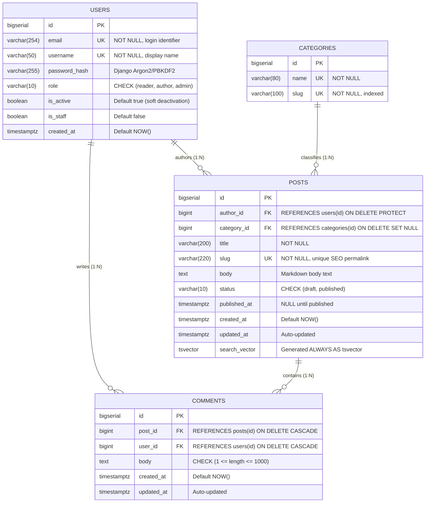

# DevScribe — Database Architecture & Relational Design
### Deliverable 03 | FalconXoft Weekend 1 Assessment

This document specifies the relational database schema, integrity constraints, indexing strategy, and cardinality models for the DevScribe platform on PostgreSQL 16+.

The accompanying DDL file is located at [schema.sql](file:///d:/Muaz/Programming/FX%20internship/Weekend%20Assessments/Blog%20Platform/submission/01_Blog/schema.sql).

---

## 1. Entity Relationship Diagram (ERD)

---

## 2. Table Specifications

### 2.1 `users`
Represents all system actors with granular role assignments.
| Column | Type | Constraints | Description |
|---|---|---|---|
| `id` | `BIGSERIAL` | `PRIMARY KEY` | Unique 64-bit integer identity. |
| `email` | `VARCHAR(254)` | `UNIQUE, NOT NULL` | System login credential. Case-insensitive unique. |
| `username` | `VARCHAR(50)` | `UNIQUE, NOT NULL` | Public handle displayed across posts and comments. |
| `password_hash`| `VARCHAR(255)` | `NOT NULL` | Cryptographically hashed password (PBKDF2 SHA-256). |
| `role` | `VARCHAR(10)` | `NOT NULL, DEFAULT 'reader'` | `CHECK (role IN ('reader', 'author', 'admin'))`. |
| `is_active` | `BOOLEAN` | `NOT NULL, DEFAULT TRUE` | Allows soft-deactivation instead of destructive hard deletes. |
| `created_at` | `TIMESTAMPTZ` | `NOT NULL, DEFAULT NOW()` | Account creation timestamp in UTC. |

### 2.2 `categories`
Organizes posts into editorial taxonomy.
| Column | Type | Constraints | Description |
|---|---|---|---|
| `id` | `BIGSERIAL` | `PRIMARY KEY` | Unique category identifier. |
| `name` | `VARCHAR(80)` | `UNIQUE, NOT NULL` | Human-readable title (e.g., "Software Engineering"). |
| `slug` | `VARCHAR(100)`| `UNIQUE, NOT NULL` | URL-safe identifier for filtering (e.g., `software-engineering`). |

### 2.3 `posts`
Contains core publication content with draft/published state machine.
| Column | Type | Constraints | Description |
|---|---|---|---|
| `id` | `BIGSERIAL` | `PRIMARY KEY` | Post identifier. |
| `author_id` | `BIGINT` | `FOREIGN KEY (users.id) ON DELETE PROTECT` | Prevents deletion of user accounts that own active posts. |
| `category_id`| `BIGINT` | `FOREIGN KEY (categories.id) ON DELETE SET NULL`| Deleting a category does not wipe articles. |
| `title` | `VARCHAR(200)`| `NOT NULL` | Article headline. |
| `slug` | `VARCHAR(220)`| `UNIQUE, NOT NULL` | Permanent URL slug with conflict resolution (`slug-1`). |
| `body` | `TEXT` | `NOT NULL` | Full article body stored as raw Markdown. |
| `status` | `VARCHAR(10)` | `NOT NULL, DEFAULT 'draft'` | `CHECK (status IN ('draft', 'published'))`. |
| `published_at`| `TIMESTAMPTZ`| `NULL` | Populated automatically when transitioning to `published`. |
| `created_at` | `TIMESTAMPTZ` | `NOT NULL, DEFAULT NOW()` | Draft initialization timestamp. |
| `updated_at` | `TIMESTAMPTZ` | `NOT NULL, DEFAULT NOW()` | Last update timestamp. |
| `search_vector`| `TSVECTOR` | `STORED GENERATED ALWAYS AS` | Precomputed vector for fast full-text searching. |

### 2.4 `comments`
Interactive discussion threads attached to published articles.
| Column | Type | Constraints | Description |
|---|---|---|---|
| `id` | `BIGSERIAL` | `PRIMARY KEY` | Comment identifier. |
| `post_id` | `BIGINT` | `FOREIGN KEY (posts.id) ON DELETE CASCADE`| Post deletion removes all nested comments. |
| `user_id` | `BIGINT` | `FOREIGN KEY (users.id) ON DELETE CASCADE`| User removal cleans up discussion contributions. |
| `body` | `TEXT` | `NOT NULL, CHECK (length BETWEEN 1 AND 1000)`| Validates comment size to prevent spam payloads. |
| `created_at` | `TIMESTAMPTZ` | `NOT NULL, DEFAULT NOW()` | Timestamp for chronological sorting. |
| `updated_at` | `TIMESTAMPTZ` | `NOT NULL, DEFAULT NOW()` | Record of edits. |

---

## 3. High-Performance Indexing Strategy

Every index is engineered to eliminate full table scans on hot queries:

| Index Name | Table & Target Columns | Type | Engineering Rationale |
|---|---|---|---|
| `idx_users_email` | `users(email)` | `UNIQUE B-TREE` | Instant $O(\log N)$ lookup during authentication requests. |
| `idx_posts_slug` | `posts(slug)` | `UNIQUE B-TREE` | Fast post retrieval for the `/posts/[slug]` public route. |
| `idx_posts_feed` | `posts(status, published_at DESC)` | `COMPOSITE B-TREE` | Eliminates sorting overhead when rendering the homepage feed. |
| `idx_posts_author`| `posts(author_id)` | `B-TREE` | Fast retrieval of user posts for Author Studio (`/me/posts/`). |
| `idx_posts_cat` | `posts(category_id)` | `B-TREE` | Accelerated filtering by category on the discovery page. |
| `idx_posts_search`| `posts USING GIN(search_vector)` | `GIN (Inverted)` | Real-time full-text search matching without external search cluster. |
| `idx_comments_post`| `comments(post_id, created_at ASC)` | `COMPOSITE B-TREE` | Enables fast single-index scan when loading comments chronologically. |

---

## 4. Referential Integrity & Deletion Policies

1. **Authors & Posts (`ON DELETE PROTECT`):**
   - If an author requests account deletion, the database rejects the command if articles exist under their authorship. Instead, administrators utilize the `is_active = FALSE` soft-deactivation flag. This prevents orphaned content and 404 links across the web.
2. **Posts & Comments (`ON DELETE CASCADE`):**
   - When a post is permanently removed, all corresponding discussion entries are automatically deleted within the same database transaction.
3. **Categories & Posts (`ON DELETE SET NULL`):**
   - If an editorial category is retired or removed, existing posts retain their publication status and their `category_id` safely becomes `NULL`.
