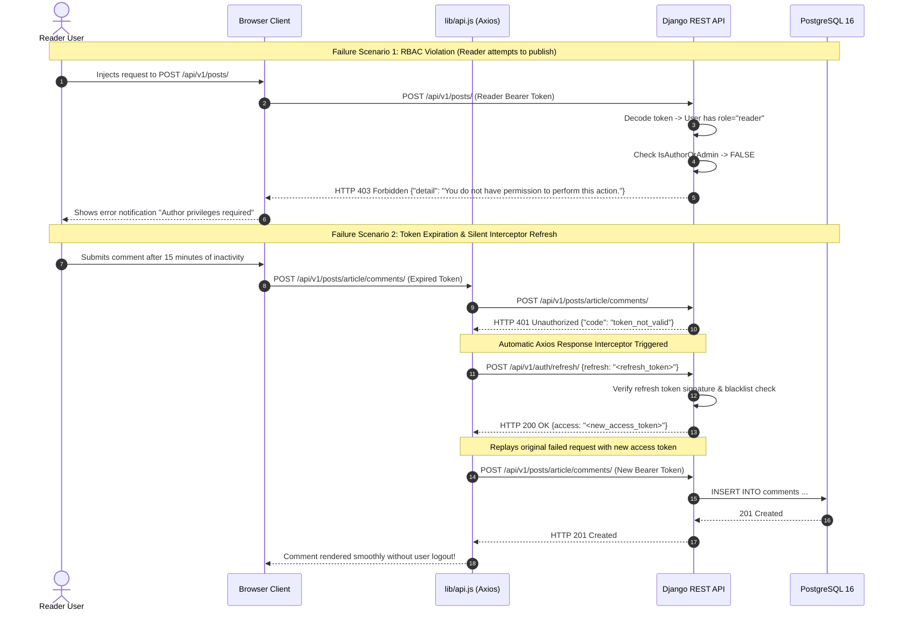

# DevScribe — API Specification & Workflows
### Deliverable 04 | FalconXoft Weekend 1 Assessment

This document details the REST API architecture, HTTP endpoint contracts, error handling taxonomy, and execution sequence diagrams for success and failure operational workflows.

The full OpenAPI 3.0 specification file is located at [openapi.yaml](file:///d:/Muaz/Programming/FX%20internship/Weekend%20Assessments/Blog%20Platform/submission/01_Blog/openapi.yaml).

---

## 1. Global API Standards

- **Base URL:** `/api/v1/`
- **Data Exchange Format:** `application/json`
- **Authentication Scheme:** HTTP Bearer Header: `Authorization: Bearer <access_token>`
- **Token Specifications:**
  - **Access Token:** Short-lived (5–15 minutes), containing claims (`user_id`, `role`, `email`).
  - **Refresh Token:** Long-lived (7 days), stored securely to obtain fresh access tokens.

---

## 2. API Endpoint Matrix

| Method | Route | Access Level | Description |
|---|---|---|---|
| `POST` | `/auth/register/` | Public | Registers a new account with default role `reader`. |
| `POST` | `/auth/login/` | Public | Authenticates credentials and returns JWT access & refresh tokens. |
| `POST` | `/auth/refresh/` | Public (Refresh JWT) | Issues a new short-lived access token using valid refresh token. |
| `GET` | `/auth/me/` | Authenticated | Returns current authenticated user profile and permissions. |
| `GET` | `/posts/` | Public | Paginated list of published posts with `?search=` and `?category=`. |
| `GET` | `/posts/{slug}/` | Public / Author | Post detail view (returns 404 to public if post is draft). |
| `POST` | `/posts/` | Author / Admin | Creates a new post (initialized in `draft` status). |
| `PATCH` | `/posts/{slug}/` | Owner / Admin | Updates title, body, or category of an existing post. |
| `DELETE`| `/posts/{slug}/` | Owner / Admin | Deletes post and cascades associated comments. |
| `POST` | `/posts/{slug}/publish/` | Owner / Admin | Transitions post status from `draft` to `published`. |
| `POST` | `/posts/{slug}/unpublish/` | Owner / Admin | Reverts published post back to `draft` status. |
| `GET` | `/me/posts/` | Author / Admin | Returns all posts authored by current user across all statuses. |
| `GET` | `/categories/` | Public | Retrieves all active blog categories. |
| `POST` | `/categories/` | Admin Only | Creates a new category and generates unique slug. |
| `DELETE`| `/categories/{id}/` | Admin Only | Deletes category (sets post category references to `NULL`). |
| `GET` | `/posts/{slug}/comments/` | Public | Returns chronological comments on a published post. |
| `POST` | `/posts/{slug}/comments/` | Authenticated | Adds a new comment (1–1000 characters). |
| `PATCH` | `/comments/{id}/` | Comment Owner | Edits comment text. |
| `DELETE`| `/comments/{id}/` | Owner / Admin | Deletes comment (admin can moderate any comment). |
| `GET` | `/admin/users/` | Admin Only | Lists all registered users with role and activation status. |
| `PATCH` | `/admin/users/{id}/` | Admin Only | Promotes/demotes user role or toggles `is_active`. |

---

## 3. Sequence Diagram 1: Success Path Workflow
### Author Logs In $\rightarrow$ Creates Draft $\rightarrow$ Publishes Article $\rightarrow$ Visitor Reads & Searches

```mermaid
sequenceDiagram
    autonumber
    actor Author as Author User
    actor Visitor as Visitor
    participant Browser as Browser Client
    participant Next as Next.js App
    participant Django as Django REST API
    participant DB as PostgreSQL 16

    Note over Author,DB: 1. Author Authentication
    Author->>Browser: Enters credentials on /login
    Browser->>Django: POST /api/v1/auth/login/ {email, password}
    Django->>DB: Query user by email & verify hash
    DB-->>Django: User Record (role: "author")
    Django-->>Browser: 200 OK {access_token, refresh_token, role: "author"}

    Note over Author,DB: 2. Create Draft Article
    Author->>Browser: Types title & markdown body on /dashboard/posts/new
    Browser->>Django: POST /api/v1/posts/ (Bearer Token)
    Django->>Django: Enforce IsAuthorOrAdmin permission
    Django->>Django: Auto-generate slug ("mastering-web-architecture")
    Django->>DB: INSERT INTO posts (status="draft", author_id=...)
    DB-->>Django: 201 Created (post_id=42, status="draft")
    Django-->>Browser: 201 Created (Redirect to Author Studio)

    Note over Author,DB: 3. Publish Article
    Author->>Browser: Clicks "Publish Now"
    Browser->>Django: POST /api/v1/posts/mastering-web-architecture/publish/
    Django->>DB: UPDATE posts SET status='published', published_at=NOW()
    DB-->>Django: Row Updated
    Django-->>Browser: 200 OK {status: "published"}

    Note over Visitor,DB: 4. Public Discovery & Full-Text Search
    Visitor->>Browser: Visits / and enters search term "architecture"
    Browser->>Django: GET /api/v1/posts/?search=architecture
    Django->>DB: SELECT * FROM posts WHERE status='published' AND search_vector @@ to_tsquery('architecture')
    DB-->>Django: List of matching published posts
    Django-->>Browser: 200 OK {results: [...]}
    Browser-->>Visitor: Displays published article card
```

---

## 4. Sequence Diagram 2: Failure Paths & Token Refresh
### Path A: Reader Role Violation (403) | Path B: Expired Access Token & Seamless Refresh (401 $\rightarrow$ 200)

---

## 5. HTTP Error Taxonomy

The API adheres to standard HTTP status codes:

| HTTP Status | Condition | Example Response Body |
|---|---|---|
| **`400 Bad Request`** | Validation failure (mismatched password, missing fields). | `{"email": ["Enter a valid email address."]}` |
| **`401 Unauthorized`** | Missing, invalid, or expired JWT access token. | `{"detail": "Authentication credentials were not provided."}` |
| **`403 Forbidden`** | Authenticated user lacks RBAC permissions for the target route. | `{"detail": "You do not have permission to perform this action."}` |
| **`404 Not Found`** | Resource does not exist, or unauthenticated request to a draft post. | `{"detail": "Not found."}` |
| **`409 Conflict`** | Duplicate unique key collision (e.g., email already registered). | `{"email": ["A user with this email already exists."]}` |
| **`429 Too Many Requests`** | API request throttling exceeded (Rate Limiting). | `{"detail": "Request was throttled. Expected available in 60 seconds."}` |
